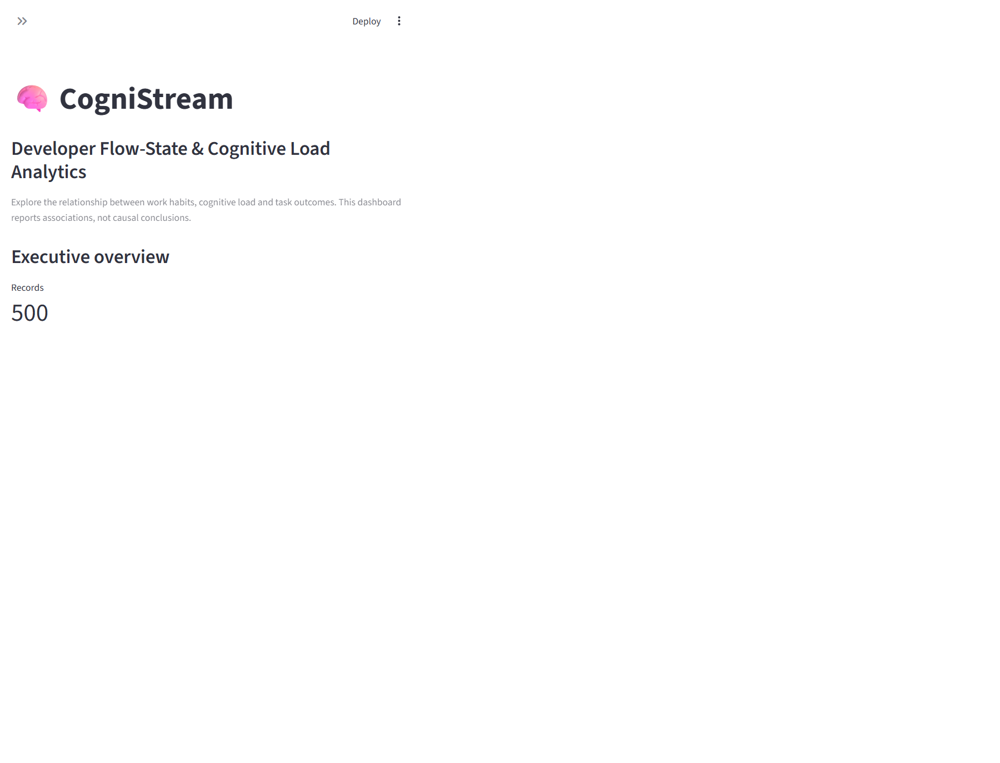

# CogniStream: Developer Flow-State & Cognitive Load Analytics

CogniStream is a data analytics project that explores the relationship between
developer work habits, cognitive load, productivity signals, and task outcomes.
It includes a reproducible data-cleaning pipeline, exploratory data analysis
(EDA), a Streamlit dashboard, and a project presentation.

> **Important:** The results describe associations in the available dataset.
> They do not prove that any specific behavior causes task success or failure.

## Project highlights

- 500 cleaned developer productivity records
- 9 behavioral and productivity features
- Task success rate, cognitive-load groups, and productivity comparisons
- Interactive Streamlit dashboard with sidebar filters
- Reproducible CSV cleaning and EDA scripts
- Generated charts, summary tables, and presentation assets

## Dashboard

The dashboard provides:

- Executive KPI cards for records, task success rate, cognitive load, coding
  hours, and reported bugs
- Successful vs. unsuccessful task outcome comparisons
- Success rate by cognitive-load group
- Coding hours vs. cognitive-load scatter plot
- Bugs and distractions summary by cognitive-load group
- Selectable feature comparison between task outcomes



## Dataset

The cleaned dataset is available at
[`data/processed/ai_dev_productivity_cleaned.csv`](data/processed/ai_dev_productivity_cleaned.csv).
The columns are:

| Column | Description |
| --- | --- |
| `hours_coding` | Hours spent coding |
| `coffee_intake_mg` | Reported coffee intake in milligrams |
| `distractions` | Number of reported distractions |
| `sleep_hours` | Hours of sleep |
| `commits` | Number of commits |
| `bugs_reported` | Number of reported bugs |
| `ai_usage_hours` | Hours of AI-tool usage |
| `cognitive_load` | Cognitive-load score from 1 to 10 |
| `task_success` | Binary task outcome: `1` successful, `0` unsuccessful |

The dataset does not currently contain dates, developer IDs, or team IDs.
Therefore, it is suitable for cross-sectional analysis, but not for tracking
individual trends or making team-level workforce decisions.

## Run locally

From the project root on Windows PowerShell:

```powershell
python -m venv .venv
.\.venv\Scripts\python.exe -m pip install -r .\dashboard\requirements.txt
.\.venv\Scripts\python.exe -m streamlit run .\dashboard\app.py
```

The dashboard normally opens at
[`http://localhost:8501`](http://localhost:8501).

## Reproduce the analysis

Clean and validate the raw CSV:

```powershell
.\.venv\Scripts\python.exe .\src\clean_data.py
```

Generate EDA summary tables and charts:

```powershell
.\.venv\Scripts\python.exe .\src\eda_analysis.py
```

Generated EDA outputs are stored in [`outputs/eda`](outputs/eda), and the
written findings are available in
[`reports/EDA_FINDINGS.md`](reports/EDA_FINDINGS.md).

## Repository structure

```text
├── dashboard/       Streamlit application, requirements, and screenshot
├── data/
│   ├── raw/         Original input CSV
│   └── processed/   Cleaned analysis-ready CSV
├── intractions/     Project instructions and supporting documents
├── notebooks/       EDA notebook files
├── outputs/eda/     Generated charts and summary tables
├── presentation/    Project presentation and generation script
├── reports/         Written EDA findings
└── src/             Data cleaning and EDA scripts
```

## Technology stack

- Python
- pandas
- Matplotlib
- Seaborn
- Streamlit
- Jupyter Notebook

## License

This project was created for academic and internship project work. Add an
appropriate license before redistributing it publicly.
